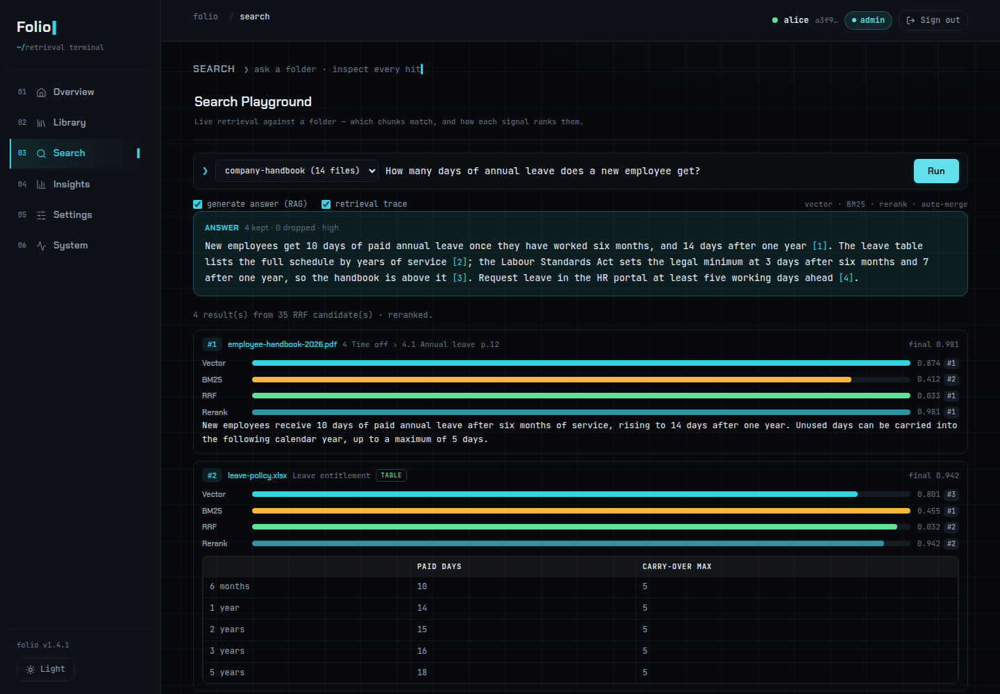

# Folio

[](LICENSE)
[](https://github.com/xianhong1208/folio-rag/actions/workflows/backend.yml)
[](https://github.com/xianhong1208/folio-rag/actions/workflows/frontend.yml)
[](https://github.com/xianhong1208/folio-rag/releases)

**Turn a folder of documents into a search tool for Claude, Cursor and any other MCP client: hybrid vector + Chinese BM25 retrieval, a reranker, and auto-merged passages, one `Folio_<folder>` tool per folder.**

[Documentation](docs/how-it-works.md) · [繁體中文](README.zh-TW.md) · [Roadmap](ROADMAP.md) · [Changelog](CHANGELOG.md)



Folio is an open-source retrieval-augmented generation (RAG) server for the Model Context Protocol.
Each folder becomes a `Folio_<folder>` tool with three modes, **search**, **list** and **read**. It
is an OAuth 2.1 **resource server**: it verifies tokens offline and never issues them, and pairs
with [MCP Gate](https://github.com/xianhong1208/MCP_Gate) as the authorization server. Folio was
called *Agentic RAG* up to v1.1.0; the database names (`agentic_rag`) and the storage layout keep
the old name, and nothing needs migrating.

## What's new

**1.4.1:** folders belong to the person, not to one token, so every personal access token and OAuth
sign-in of one MCP Gate user sees the same folders; signing out ends the console session on the
server; answers come in the question's language. See the [CHANGELOG](CHANGELOG.md), and the
[ROADMAP](ROADMAP.md) for what comes next (1.5: a Docker image, backups, and documents and speech
read through OpenAI-compatible APIs).

> **Changed in 1.5 (on `dev`, not released yet):** `config/config.yaml` is split into six files
> under `config/` with every secret and per-machine value in `.env`, and the old file is no longer
> read; `rag.answer_llm` and `rag.eval_llm` are removed (answers and evaluation use `rag.llm`).
> `scripts/split_config.py` converts a 1.4 config: see
> [Upgrading from 1.4](docs/configuration.md#upgrading-from-14).

> **Removed in 1.5 (on `dev`):** every in-process OCR, layout and speech model, and the `/v1`
> media endpoints (now 410 Gone). PDFs and images are read by an OpenAI-compatible **vision model**
> when you set one (`rag.parsing.vision`, e.g. Qwen3-VL on
> [Forgeyard](https://github.com/xianhong1208/forgeyard)); without one, PDFs are read from their
> text layer (a scanned page becomes a marker) and image uploads are refused. Audio goes to an
> OpenAI-compatible transcription endpoint (`rag.asr`, e.g. whisper-large-v3-turbo). A config that
> still has `rag.docling`, `rag.parsing.images`, `rag.parsing.pdf: local`/`cloud` or an old speech
> provider stops the start. See [Upgrading to 1.5](docs/migrate-1.5.md).

## Key features

- **Hierarchical chunks that merge back.** Small leaves for precise matching, large parents for
  context, never across a section; several hits in one passage come back as the whole passage.
- **Hybrid search, tuned for Chinese.** Dense vectors (pgvector) and BM25 fused with Reciprocal
  Rank Fusion; Chinese is word-segmented first (CKIP, jieba or bigram).
- **Cross-encoder reranking** (`mxbai-rerank-base-v2`, `bge-reranker-v2-m3`), and MCP search says
  when nothing relevant was found.
- **Contextual retrieval.** An LLM writes a short context line for each chunk at index time;
  re-indexing an edited file only redoes the chunks that changed. Files indexed by an older
  chunking pipeline or another embedding model are marked for re-indexing.
- **Per-person folders.** You only see the folders of your MCP Gate account, over MCP, REST and the
  console alike.
- **Tags and metadata on documents.** Label files with tags and flat key/value metadata (client,
  year, a due date…), then filter a search or list documents across all your folders by them
  ([document filters](docs/api.md#document-filters)).
- **Many formats.** PDF, Office (including legacy and RTF), OpenDocument, HTML and MHTML, Markdown,
  EPUB, email, scanned PDFs and images (read by a vision model such as Qwen3-VL, tables kept as
  tables; without one, PDFs are read from their text layer), and audio (transcribed by an
  OpenAI-compatible endpoint, with Simplified Chinese turned into Traditional).
- **Measured, not guessed.** A public 205-question golden set and an evaluation harness; the
  console scores your own folders on Recall@k, MRR and nDCG@k.
- **A console** at `/admin`: folders and files, a Search Playground with the per-signal trace, index
  jobs, query analytics and knowledge gaps, evaluation, live settings, health and an audit log.
- **Backup and restore in one command.** `main.py backup` archives the database, every folder's
  vectors and the stored files together, with a manifest that `main.py restore` checks; the server
  can also back up on a schedule. `main.py export-folder` / `import-folder` move one folder, with its
  files and index, to another Folio or keep a copy of it — also from the console's Folders page.
- **Prometheus metrics** at [`/metrics`](docs/metrics.md): requests, per-stage search latency, MCP
  tool calls, index jobs and model endpoint calls, with no folder or user names in any label.
- **Self-hosted or cloud models.** Embeddings, LLM, reranker, vision and speech-to-text run behind
  OpenAI-compatible endpoints on your own GPUs (e.g. Forgeyard) or a cloud API; the only in-process
  models, CKIP segmentation and optional HuggingFace embeddings, run on the CPU.

## Installation

**With Docker** (the lightweight cloud-profile image, `tonyhuang1101/folio`, plus PostgreSQL with
pgvector; every model is an OpenAI-compatible endpoint such as Forgeyard or vLLM):

```bash
git clone https://github.com/xianhong1208/folio-rag.git && cd folio-rag
cp .env.example .env      # POSTGRES_PASSWORD, the model endpoints and names, MCP Gate: the "Docker" section
docker compose up -d      # add COMPOSE_PROFILES=mcp-gate to .env to run MCP Gate in the same stack
```

The [deploy guide](docs/deploy.md) covers the image, the model endpoints, matching the issuer and
the audience with MCP Gate, a reverse proxy with HTTPS, backups and upgrades.

**From source** (needed for the in-process models of the `local` and `hybrid` profiles). You need:

- Python 3.12 and [uv](https://docs.astral.sh/uv/);
- **PostgreSQL** with the **[pgvector](https://github.com/pgvector/pgvector)** extension;
- OpenAI-compatible endpoints for the **embedding**, **LLM** and **reranker** models
  ([vLLM](https://github.com/vllm-project/vllm), Ollama, [Forgeyard](https://github.com/xianhong1208/forgeyard)
  or a cloud provider);
- LibreOffice (`soffice`) for legacy Office files and RTF.

```bash
git clone https://github.com/xianhong1208/folio-rag.git
cd folio-rag

# In-process models (CKIP, HuggingFace embeddings) need the `local` extra, which brings the
# CPU build of torch. All-cloud: plain `uv sync`.
uv sync --extra local

cp .env.example .env         # DATABASE_URL (PostgreSQL + pgvector), model endpoints and keys,
                             # MCP_GATE_URL / FOLIO_AUDIENCE: every secret and per-machine value
# models, retrieval tuning, port: config/models.yaml, retrieval.yaml, system.yaml (no secrets there)

uv run python main.py        # creates the schema and runs migrations on start
```

Folio listens on `http://0.0.0.0:5039`: the MCP endpoint is `/mcp` and the console is `/admin`.
Run it as the user that owns `.venv`: NLTK 3.10.4+ refuses data files owned or writable by another
account, and long plain-text paragraphs then fail to split (`chown -R <service user> .venv`).

## Quick start

Folio authenticates through [MCP Gate](https://github.com/xianhong1208/MCP_Gate). Register Folio
there first: MCP Gate only issues tokens for audiences it knows.

**1. Register the server in MCP Gate.** *Services → Register Service*, with this server's host, port
and path (`/mcp`). The audience defaults to the MCP URL, for example `http://127.0.0.1:5039/mcp`.

**2. Point Folio at MCP Gate** in `.env` (`config/auth.yaml` reads them):

```bash
MCP_GATE_URL=http://localhost:4568          # MCP Gate base URL (RS256 JWKS issuer)
FOLIO_AUDIENCE=http://127.0.0.1:5039/mcp    # must equal the audience registered in MCP Gate
```

**3. Create a folder and add documents**, in the console (*Library → New Folder → Upload Files*,
signed in with a personal access token from MCP Gate) or over REST:

```bash
curl -X POST http://127.0.0.1:5039/api/folders/ \
  -H "Authorization: Bearer <TOKEN>" -H "Content-Type: application/json" \
  -d '{"name":"product-docs"}'
```

**4. Connect a client.** An OAuth-capable client needs nothing up front:

```bash
claude mcp add --transport http folio http://127.0.0.1:5039/mcp
```

On first use the client registers with MCP Gate and shows the consent screen; then the
`Folio_product-docs` tool appears. For scripts, pass a personal access token as a bearer header.

**5. Ask.**

```
Folio_product-docs  mode="search"  query="how do I rotate the signing key?"
```

You get the matching passages, merged where they belong together, each with a relevance score and
its source file and heading.

## Deployment options

| Profile | Models | Install |
|---|---|---|
| `local` (default) | Anything goes. The shipped config calls self-hosted embedding, LLM and reranker endpoints, and runs CKIP segmentation in-process; the vision model and speech-to-text are always endpoints | `uv sync --extra local` |
| `hybrid` | The same, for a mix of self-hosted and cloud endpoints; API keys written literally in the config files are warned about | as `local` |
| `cloud` | Every role is an HTTP endpoint and keys must be `${ENV}` references; no torch and no model downloads | `uv sync` |

Set it with `rag.profile`; see [Cloud profile](docs/configuration.md#cloud-profile). The **Docker
image** is the `cloud` profile, with a compose file for PostgreSQL + pgvector and an optional MCP
Gate; the in-process models need an install from source. Keep the console on a trusted network or
behind a reverse proxy with HTTPS; `/mcp` and
`/api/rag/*` need a valid token. The [deploy guide](docs/deploy.md) has nginx and Caddy examples,
backups and upgrades. The database and `storage/` (the uploads) belong together: startup refuses
when one of them is missing, [rather than starting without the data](docs/deploy.md#when-one-piece-is-missing).

## Documentation

| | |
|---|---|
| [How it works](docs/how-it-works.md) | the pipeline, retrieval in detail (BM25, segmentation, reranking, latency, relevance cutoff), measuring retrieval, every feature in detail |
| [Deploying Folio](docs/deploy.md) | the Docker image and compose file, model endpoints (Forgeyard, vLLM), the issuer and audience with MCP Gate, a reverse proxy with HTTPS, backups, upgrades |
| [Configuration](docs/configuration.md) | the six config files and `.env`, every setting you are likely to touch, the cloud profile, upgrading from 1.4 |
| [Upgrading to 1.5](docs/migrate-1.5.md) | the vision model for PDFs and images (Qwen3-VL on Forgeyard) or the text layer, speech-to-text through an endpoint, a private CA, what happens to an old configuration |
| [Authentication](docs/auth.md) | folder ownership by MCP Gate user, and the token revocation feed |
| [Console](docs/console.md) | signing in, the two permission tiers, each page, re-indexing after an upgrade or an embedding model change |
| [API reference](docs/api.md) | MCP, REST, console and health endpoints |
| [Backup and restore](docs/backup.md) | `main.py backup` / `restore`, scheduled backups, moving to another machine, exporting and importing one folder |
| [PostgreSQL operations](docs/operations-postgres.md) | connection budget and database upkeep |
| [Metrics](docs/metrics.md) | Prometheus `/metrics`: what is measured, protecting it, scrape config and example queries |
| [Development](docs/development.md) | architecture, checks, CI and releasing |
| [Retrieval evaluation](evals/README.md) | the golden set, the harness and the baselines |

## Contributing

Issues and pull requests are welcome. Branch off `dev` and open the pull request into `dev`. Code and comments are in
English; the console is English only by decision. Run the checks in
[docs/development.md](docs/development.md) first: `uv run pytest`, `uvx ruff check .`, and
`npm test` plus `npm run build` in `frontend/` when you change the console.

## Licence

[MIT](LICENSE). PDF pages are rendered with PDFium (`pypdfium2`, Apache-2.0 / BSD-3-Clause), not
the AGPL-licensed PyMuPDF.

### Third-party licences

Folio's own code is MIT. Some optional parts carry other licences; check them before you
redistribute an install or an image that includes them:

- `--extra local`: `ckip-transformers` and the CKIP models it downloads are **GPL-3.0**. The
  `jieba` (MIT) and `bigram` segmenters avoid it; the published Docker image does not include it.
- The Docker image adds PostgreSQL's client tools (PostgreSQL Licence) and Debian packages, each
  under its own licence.
