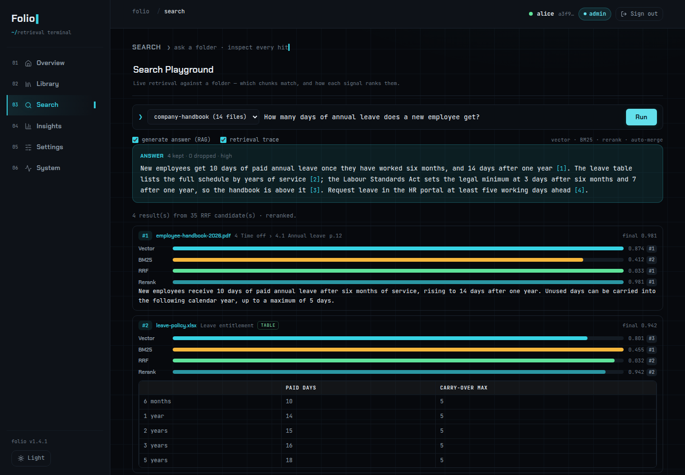

# Folio

[](LICENSE)
[](https://github.com/xianhong1208/folio-rag/actions/workflows/backend.yml)
[](https://github.com/xianhong1208/folio-rag/actions/workflows/frontend.yml)
[](https://github.com/xianhong1208/folio-rag/releases)

**Turn a folder of documents into a search tool for Claude, Cursor and any other MCP client: hybrid vector + Chinese BM25 retrieval, a reranker, and auto-merged passages, one `Folio_<folder>` tool per folder.**

[Documentation](docs/how-it-works.md) · [繁體中文](README.zh-TW.md) · [Roadmap](ROADMAP.md) · [Changelog](CHANGELOG.md)



Folio is an open-source retrieval-augmented generation (RAG) server for the Model Context Protocol.
Each folder becomes a `Folio_<folder>` tool with three modes, **search**, **list** and **read**. It
is an OAuth 2.1 **resource server**: it verifies tokens offline and never issues them, and pairs
with [MCP Gate](https://github.com/xianhong1208/MCP_Gate) as the authorization server. Folio was
called *Agentic RAG* up to v1.1.0; the database names (`agentic_rag`) and the storage layout keep
the old name, and nothing needs migrating.

## What's new

**1.4.1:** folders belong to the person, not to one token, so every personal access token and OAuth
sign-in of one MCP Gate user sees the same folders; signing out ends the console session on the
server; answers come in the question's language. See the [CHANGELOG](CHANGELOG.md), and the
[ROADMAP](ROADMAP.md) for what comes next (1.5: a Docker image, backups, and OCR and speech through
an OpenAI-compatible API).

> **Removed in 1.5:** the built-in OCR, the built-in speech-to-text (FireRedASR, docling-whisper)
> and the `/v1` media endpoints. 1.4.x keeps them working and warns in the log; `/v1` responses
> carry a `Deprecation` header. Move to an OpenAI-compatible vision model for scanned PDFs and
> images and an OpenAI-compatible transcription endpoint for audio, for example both served by
> [Forgeyard](https://github.com/xianhong1208/forgeyard). See
> [what replaces them](docs/api.md#removed-in-15-built-in-ocr-speech-to-text-and-the-v1-media-endpoints).

## Key features

- **Hierarchical chunks that merge back.** Small leaves for precise matching, large parents for
  context, never across a section; several hits in one passage come back as the whole passage.
- **Hybrid search, tuned for Chinese.** Dense vectors (pgvector) and BM25 fused with Reciprocal
  Rank Fusion; Chinese is word-segmented first (CKIP, jieba or bigram).
- **Cross-encoder reranking** (`mxbai-rerank-base-v2`, `bge-reranker-v2-m3`), and MCP search says
  when nothing relevant was found.
- **Contextual retrieval.** An LLM writes a short context line for each chunk at index time;
  re-indexing an edited file only redoes the chunks that changed. Files indexed by an older
  chunking pipeline or another embedding model are marked for re-indexing.
- **Per-person folders.** You only see the folders of your MCP Gate account, over MCP, REST and the
  console alike.
- **Many formats.** PDF, Office (including legacy and RTF), OpenDocument, HTML and MHTML, Markdown,
  EPUB, email, images with OCR, and audio.
- **Measured, not guessed.** A public 205-question golden set and an evaluation harness; the
  console scores your own folders on Recall@k, MRR and nDCG@k.
- **A console** at `/admin`: folders and files, a Search Playground with the per-signal trace, index
  jobs, query analytics and knowledge gaps, evaluation, live settings, health and an audit log.
- **Local GPU, CPU or cloud.** AMD ROCm, NVIDIA CUDA or CPU for in-process models, or every model
  behind an OpenAI-compatible API with no torch at all.

## Installation

You need:

- Python 3.12 and [uv](https://docs.astral.sh/uv/);
- **PostgreSQL** with the **[pgvector](https://github.com/pgvector/pgvector)** extension;
- OpenAI-compatible endpoints for the **embedding**, **LLM** and **reranker** models
  ([vLLM](https://github.com/vllm-project/vllm), Ollama, [Forgeyard](https://github.com/xianhong1208/forgeyard)
  or a cloud provider);
- LibreOffice (`soffice`) for legacy Office files and RTF.

```bash
git clone https://github.com/xianhong1208/folio-rag.git
cd folio-rag

# Local models need the `local` extra, and torch comes from a dependency group:
# always pass one of rocm-r714 | cuda | cpu with it (cuda = CUDA 13.0, NVIDIA driver 580+).
# All-cloud: plain `uv sync`.
uv sync --extra local --group cuda

cp .env.example .env         # set DATABASE_URL (PostgreSQL + pgvector)
# edit config/config.yaml: rag.embedding / rag.llm / rag.rerank endpoints,
#                          auth.issuer / auth.audience, server.port

uv run python main.py        # creates the schema and runs migrations on start
```

Folio listens on `http://0.0.0.0:5039`: the MCP endpoint is `/mcp` and the console is `/admin`.
Run it as the user that owns `.venv`: NLTK 3.10.4+ refuses data files owned or writable by another
account, and long plain-text paragraphs then fail to split (`chown -R <service user> .venv`).

## Quick start

Folio authenticates through [MCP Gate](https://github.com/xianhong1208/MCP_Gate). Register Folio
there first: MCP Gate only issues tokens for audiences it knows.

**1. Register the server in MCP Gate.** *Services → Register Service*, with this server's host, port
and path (`/mcp`). The audience defaults to the MCP URL, for example `http://127.0.0.1:5039/mcp`.

**2. Point Folio at MCP Gate** in `config/config.yaml`:

```yaml
auth:
  enabled: true
  issuer:   "http://localhost:4568"          # MCP Gate base URL (RS256 JWKS issuer)
  audience: "http://127.0.0.1:5039/mcp"      # must equal the audience registered in MCP Gate
```

**3. Create a folder and add documents**, in the console (*Library → New Folder → Upload Files*,
signed in with a personal access token from MCP Gate) or over REST:

```bash
curl -X POST http://127.0.0.1:5039/api/folders/ \
  -H "Authorization: Bearer <TOKEN>" -H "Content-Type: application/json" \
  -d '{"name":"product-docs"}'
```

**4. Connect a client.** An OAuth-capable client needs nothing up front:

```bash
claude mcp add --transport http folio http://127.0.0.1:5039/mcp
```

On first use the client registers with MCP Gate and shows the consent screen; then the
`Folio_product-docs` tool appears. For scripts, pass a personal access token as a bearer header.

**5. Ask.**

```
Folio_product-docs  mode="search"  query="how do I rotate the signing key?"
```

You get the matching passages, merged where they belong together, each with a relevance score and
its source file and heading.

## Deployment options

| Profile | Models | Install |
|---|---|---|
| `local` (default) | Anything goes. The shipped config calls self-hosted embedding, LLM and reranker endpoints, and runs CKIP segmentation, Docling parsing with OCR and FireRedASR speech-to-text in-process | `uv sync --extra local --group rocm-r714 \| cuda \| cpu` |
| `hybrid` | The same, for a mix of self-hosted and cloud endpoints; API keys written literally in `config.yaml` are warned about | as `local` |
| `cloud` | Every role is an HTTP endpoint and keys must be `${ENV}` references; no torch and no model downloads | `uv sync` |

Set it with `rag.profile`; see [Cloud profile](docs/configuration.md#cloud-profile). Keep the
console and the unauthenticated `/v1` media endpoints on a trusted network or behind a reverse
proxy with HTTPS; `/mcp` and `/api/rag/*` need a valid token. A Docker image and compose file are
planned for 1.5.

## Documentation

| | |
|---|---|
| [How it works](docs/how-it-works.md) | the pipeline, retrieval in detail (BM25, segmentation, reranking, latency, relevance cutoff), measuring retrieval, every feature in detail |
| [Configuration](docs/configuration.md) | every setting you are likely to touch, and the cloud profile |
| [Authentication](docs/auth.md) | folder ownership by MCP Gate user, and the token revocation feed |
| [Console](docs/console.md) | signing in, the two permission tiers, each page, re-indexing after an upgrade or an embedding model change |
| [API reference](docs/api.md) | MCP, REST, console and health endpoints |
| [PostgreSQL operations](docs/operations-postgres.md) | connection budget and database upkeep |
| [Development](docs/development.md) | architecture, checks, CI and releasing |
| [Retrieval evaluation](evals/README.md) | the golden set, the harness and the baselines |

## Contributing

Issues and pull requests are welcome. Branch off `dev` and open the pull request into `dev`. Code and comments are in
English; the console is English only by decision. Run the checks in
[docs/development.md](docs/development.md) first: `uv run pytest`, `uvx ruff check .`, and
`npm test` plus `npm run build` in `frontend/` when you change the console.

## Licence

[MIT](LICENSE)
