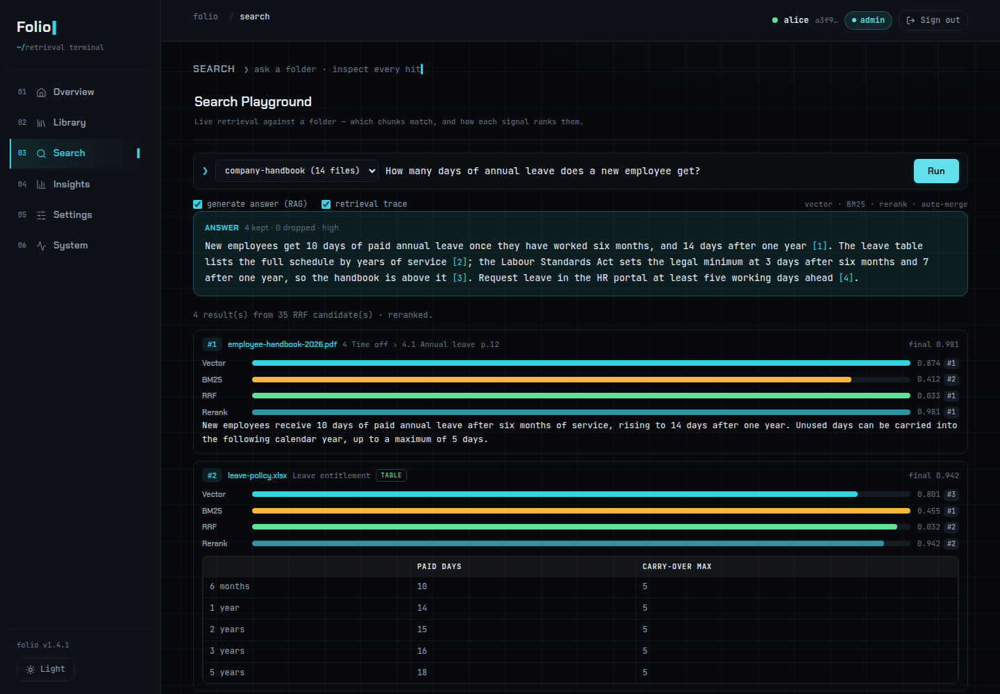

# Folio

[](LICENSE)
[](https://github.com/xianhong1208/folio-rag/actions/workflows/backend.yml)
[](https://github.com/xianhong1208/folio-rag/actions/workflows/frontend.yml)
[](https://github.com/xianhong1208/folio-rag/releases)

**把一個文件資料夾變成 Claude、Cursor 等任何 MCP 用戶端都能用的搜尋工具:向量 + 中文 BM25 混合檢索、重排,以及自動合併的完整段落,每個資料夾一個 `Folio_<folder>` 工具。**

[文件](docs/how-it-works.zh-TW.md) · [English](README.md) · [路線圖](ROADMAP.zh-TW.md) · [更新紀錄](CHANGELOG.md)



Folio 是一套開源、給 Model Context Protocol 用的檢索增強生成(RAG)伺服器。每個資料夾會成為一個
`Folio_<folder>` 工具,有 **search**、**list**、**read** 三種模式。它是 OAuth 2.1 的
**resource server**:只在本地離線驗證 token,從不簽發,搭配 [MCP Gate](https://github.com/xianhong1208/MCP_Gate)
當授權伺服器。Folio 在 v1.1.0 以前叫 *Agentic RAG*;資料庫名稱(`agentic_rag`)與儲存目錄結構沿用舊名,
不需要任何遷移。

## 最新消息

**1.4.1:** 資料夾屬於「人」而不是某一把 token,同一位 MCP Gate 使用者的每一把 personal access token
與 OAuth 登入都看到同一組資料夾;登出會在伺服器端結束主控台 session;答案使用提問的語言。詳見
[CHANGELOG](CHANGELOG.md);接下來的規劃見[路線圖](ROADMAP.zh-TW.md)(1.5:Docker 映像檔、備份,以及
透過 OpenAI 相容 API 讀取文件與語音)。

> **1.5 的變更(已在 `dev`,尚未發佈):** `config/config.yaml` 拆成 `config/` 底下的六個檔案,所有機密與每台機器各自的值
> 都放在 `.env`,舊檔不再讀取;移除 `rag.answer_llm` 與 `rag.eval_llm`(回答與評估都用 `rag.llm`)。
> `scripts/split_config.py` 可轉換 1.4 的設定,詳見[從 1.4 升級](docs/configuration.zh-TW.md#從-14-升級)。

> **1.5 已移除(已在 `dev`):** 所有在程序內執行的 OCR、版面與語音模型,以及 `/v1` 媒體端點(現在回 410 Gone)。
> 設定了 OpenAI 相容的**視覺模型**時(`rag.parsing.vision`,例如 [Forgeyard](https://github.com/xianhong1208/forgeyard)
> 上的 Qwen3-VL),PDF 與圖片由它讀取;沒有設定時,PDF 從文字層讀取(掃描頁會變成一個標記),圖片則拒絕上傳。
> 音訊送到 OpenAI 相容的轉錄端點(`rag.asr`,例如 whisper-large-v3-turbo)。設定若仍有 `rag.docling`、
> `rag.parsing.images`、`rag.parsing.pdf: local`/`cloud` 或舊的語音 provider,啟動會被拒絕。詳見
> [升級到 1.5](docs/migrate-1.5.zh-TW.md)。

## 主要功能

- **會合併回來的階層式切塊。** 小的 leaf 用來精準比對,大的 parent 提供完整脈絡,兩者都不跨章節;同一段落
  多處命中時,回傳的是整段。
- **為中文調校的混合搜尋。** 向量(pgvector)與 BM25 以 Reciprocal Rank Fusion 融合;中文先斷詞
  (CKIP、jieba 或 bigram)。
- **Cross-encoder 重排**(`mxbai-rerank-base-v2`、`bge-reranker-v2-m3`),MCP 搜尋也會說明「找不到相關
  內容」。
- **Contextual retrieval。** 索引時由 LLM 為每個 chunk 寫一句脈絡說明;重新索引改過的檔案時,只重做有變動的
  chunk。以舊版切塊流程或其他 embedding 模型索引的檔案,會標示需要重新索引。
- **每人各自的資料夾。** 你只看得到自己 MCP Gate 帳號的資料夾,MCP、REST 與主控台都一樣。
- **文件的標籤與 metadata。** 為檔案加上標籤與扁平的 key/value metadata(客戶、年份、到期日…),再用它們
  篩選搜尋,或列出你所有資料夾裡符合條件的文件([文件篩選](docs/api.zh-TW.md#文件篩選))。
- **多種格式。** PDF、Office(含舊版與 RTF)、OpenDocument、HTML 與 MHTML、Markdown、EPUB、電子郵件、
  掃描的 PDF 與圖片(由 Qwen3-VL 等視覺模型讀取,表格保持表格;沒有視覺模型時 PDF 從文字層讀取)與音訊
  (由 OpenAI 相容端點轉錄,簡體中文會轉成繁體)。
- **用數字說話。** 公開的 205 題黃金測試集與評測工具;主控台可以用 Recall@k、MRR、nDCG@k 為你自己的
  資料夾評分。
- **主控台**在 `/admin`:資料夾與檔案、顯示逐訊號軌跡的 Search Playground、索引任務、查詢分析與知識缺口、
  評測、即時設定、健康狀態與稽核紀錄。
- **一個指令備份與還原。** `main.py backup` 把資料庫、每個資料夾的向量與儲存的檔案一起封存,附上一份
  `main.py restore` 會檢查的 manifest;伺服器也能依排程自動備份。`main.py export-folder` /
  `import-folder` 可以把單一資料夾連同檔案與索引搬到另一個 Folio,或留一份副本;console 的 Folders 頁面也能做。
- **Prometheus 監控指標**在 [`/metrics`](docs/metrics.zh-TW.md):請求、搜尋各階段延遲、MCP 工具呼叫、
  索引工作與模型端點呼叫,任何標籤都不含資料夾或使用者名稱。
- **自架或雲端模型。** Embedding、LLM、reranker、視覺模型與語音轉文字都走 OpenAI 相容端點,可以是你自己
  GPU 上的服務(例如 Forgeyard)或雲端 API;僅有的行程內模型 —— CKIP 斷詞與選用的 HuggingFace embedding ——
  跑在 CPU 上。

## 安裝

**用 Docker**（輕量的雲端 profile 映像檔 `tonyhuang1101/folio`，加上 PostgreSQL 與 pgvector；所有模型都是
OpenAI 相容端點，例如 Forgeyard 或 vLLM）：

```bash
git clone https://github.com/xianhong1208/folio-rag.git && cd folio-rag
cp .env.example .env      # POSTGRES_PASSWORD、模型端點與名稱、MCP Gate：見「Docker」一節
docker compose up -d      # 在 .env 加上 COMPOSE_PROFILES=mcp-gate，就會在同一個 stack 跑 MCP Gate
```

[部署指南](docs/deploy.zh-TW.md)說明映像檔、模型端點、issuer 與 audience 如何和 MCP Gate 對齊、反向代理與
HTTPS、備份和升級。

**從原始碼安裝**（`local` 與 `hybrid` profile 的程序內模型需要這種方式）。你需要：

- Python 3.12 與 [uv](https://docs.astral.sh/uv/);
- 裝了 **[pgvector](https://github.com/pgvector/pgvector)** 擴充的 **PostgreSQL**;
- **embedding**、**LLM** 與 **reranker** 模型的 OpenAI 相容端點([vLLM](https://github.com/vllm-project/vllm)、
  Ollama、[Forgeyard](https://github.com/xianhong1208/forgeyard) 或雲端服務);
- 處理舊版 Office 檔與 RTF 需要 LibreOffice(`soffice`)。

```bash
git clone https://github.com/xianhong1208/folio-rag.git
cd folio-rag

# 行程內模型(CKIP、HuggingFace embedding)需要 `local` extra,它會帶入 CPU 版的 torch。
# 全雲端:直接 `uv sync`。
uv sync --extra local

cp .env.example .env         # DATABASE_URL(PostgreSQL + pgvector)、模型端點與金鑰、
                             # MCP_GATE_URL / FOLIO_AUDIENCE:所有機密與每台機器各自的值
# 模型、檢索調校、port:config/models.yaml、retrieval.yaml、system.yaml(裡面沒有機密)

uv run python main.py        # 啟動時會建立 schema 並執行 migration
```

Folio 監聽 `http://0.0.0.0:5039`:MCP 端點是 `/mcp`,主控台是 `/admin`。請用擁有 `.venv` 的使用者執行:
NLTK 3.10.4 起會拒絕其他帳號擁有或可寫入的資料檔,較長的純文字段落就會無法切分
(`chown -R <執行服務的使用者> .venv`)。

## 快速開始

Folio 透過 [MCP Gate](https://github.com/xianhong1208/MCP_Gate) 驗證身分。請先在 MCP Gate 註冊 Folio:
MCP Gate 只會為它認得的 audience 簽發 token。

**1. 在 MCP Gate 註冊伺服器。** *Services → Register Service*,填入這台伺服器的 host、port 與路徑
(`/mcp`)。audience 預設就是 MCP 網址,例如 `http://127.0.0.1:5039/mcp`。

**2. 讓 Folio 指向 MCP Gate**,寫在 `.env`(由 `config/auth.yaml` 讀取):

```bash
MCP_GATE_URL=http://localhost:4568          # MCP Gate 網址(RS256 JWKS issuer)
FOLIO_AUDIENCE=http://127.0.0.1:5039/mcp    # 必須和在 MCP Gate 註冊的 audience 一字不差
```

**3. 建立資料夾並加入文件**,可以在主控台(*Library → New Folder → Upload Files*,用 MCP Gate 發的
personal access token 登入),或透過 REST:

```bash
curl -X POST http://127.0.0.1:5039/api/folders/ \
  -H "Authorization: Bearer <TOKEN>" -H "Content-Type: application/json" \
  -d '{"name":"product-docs"}'
```

**4. 連接用戶端。** 支援 OAuth 的用戶端不需要事先準備任何東西:

```bash
claude mcp add --transport http folio http://127.0.0.1:5039/mcp
```

第一次使用時,用戶端會向 MCP Gate 註冊並顯示同意畫面;之後就會出現 `Folio_product-docs` 工具。腳本則把
personal access token 放在 bearer header 傳入。

**5. 提問。**

```
Folio_product-docs  mode="search"  query="how do I rotate the signing key?"
```

你會拿到相符的段落,屬於同一段的會合併在一起,每筆都附相關度分數、來源檔案與標題。

## 部署方式

| Profile | 模型 | 安裝 |
|---|---|---|
| `local`(預設) | 什麼都可以。內附的設定呼叫自架的 embedding、LLM 與 reranker 端點,並在行程內執行 CKIP 斷詞;視覺模型與語音轉文字一律走端點 | `uv sync --extra local` |
| `hybrid` | 同上,用於自架與雲端端點混用;直接寫在設定檔裡的 API 金鑰會被警告 | 同 `local` |
| `cloud` | 每個角色都是 HTTP 端點,金鑰必須是 `${ENV}` 參照;不需要 torch,也不下載模型 | `uv sync` |

用 `rag.profile` 設定,詳見[雲端 profile](docs/configuration.zh-TW.md#雲端-profile)。主控台請只開放在可信任的網路,或放在有 HTTPS 的反向代理後面;`/mcp` 與 `/api/rag/*` 需要有效的
token。**Docker 映像檔**就是 `cloud` profile,附 PostgreSQL + pgvector 與選用 MCP Gate 的 compose 檔;
程序內模型則需要從原始碼安裝。[部署指南](docs/deploy.zh-TW.md)有 nginx 與 Caddy 範例、備份和升級。資料庫和 `storage/`(上傳檔)是同一套資料:
少了其中一個,啟動時會[拒絕啟動](docs/deploy.zh-TW.md#少了其中一部分時),不會在沒有資料的情況下跑起來。

## 文件

| | |
|---|---|
| [運作原理](docs/how-it-works.zh-TW.md) | 檢索管線、檢索細節(BM25、斷詞、重排、延遲、相關度門檻)、量測檢索品質、每項功能的細節 |
| [部署 Folio](docs/deploy.zh-TW.md) | Docker 映像檔與 compose 檔、模型端點(Forgeyard、vLLM)、issuer 與 audience 如何和 MCP Gate 對齊、反向代理與 HTTPS、備份、升級 |
| [設定](docs/configuration.zh-TW.md) | 六個設定檔與 `.env`、常用的每個設定、雲端 profile、從 1.4 升級 |
| [升級到 1.5](docs/migrate-1.5.zh-TW.md) | 讀取 PDF 與圖片的視覺模型(Forgeyard 上的 Qwen3-VL)或文字層、透過端點的語音轉文字、私有 CA、舊設定會怎樣 |
| [驗證](docs/auth.zh-TW.md) | 依 MCP Gate 使用者的資料夾歸屬,以及 token 撤銷 feed |
| [主控台](docs/console.zh-TW.md) | 登入、兩種權限層級、每個頁面、升級或更換 embedding 模型後重新索引 |
| [API 參考](docs/api.zh-TW.md) | MCP、REST、主控台與健康檢查端點 |
| [備份與還原](docs/backup.zh-TW.md) | `main.py backup` / `restore`、排程備份、搬到另一台機器、匯出與匯入單一資料夾 |
| [PostgreSQL 維運](docs/operations-postgres.md) | 連線數預算與資料庫維護(英文) |
| [監控指標](docs/metrics.zh-TW.md) | Prometheus `/metrics`:量測項目、保護方式、抓取設定與查詢範例 |
| [開發](docs/development.zh-TW.md) | 架構、檢查、CI 與發布 |
| [檢索評測](evals/README.md) | 黃金測試集、評測工具與 baseline(英文) |

## 參與貢獻

歡迎 issue 與 pull request。從 `dev` 開分支,pull request 開回 `dev`。程式碼與註解使用英文;
主控台依決定只有英文。送出前先跑 [docs/development.zh-TW.md](docs/development.zh-TW.md) 裡的檢查:
`uv run pytest`、`uvx ruff check .`,改了主控台的話再到 `frontend/` 跑 `npm test` 與 `npm run build`。

## 授權

[MIT](LICENSE)。PDF 頁面以 PDFium(`pypdfium2`,Apache-2.0 / BSD-3-Clause)轉成圖片,
不使用 AGPL 授權的 PyMuPDF。

### 第三方授權

Folio 本身的程式碼是 MIT。部分選用元件使用其他授權;若要再散布包含它們的安裝或映像,請先確認:

- `--extra local`:`ckip-transformers` 以及它下載的 CKIP 模型是 **GPL-3.0**。改用 `jieba`(MIT)或
  `bigram` 分詞器即可避開;發布的 Docker 映像不包含它。
- Docker 映像另含 PostgreSQL 用戶端工具(PostgreSQL License)與 Debian 套件,各依其授權。
